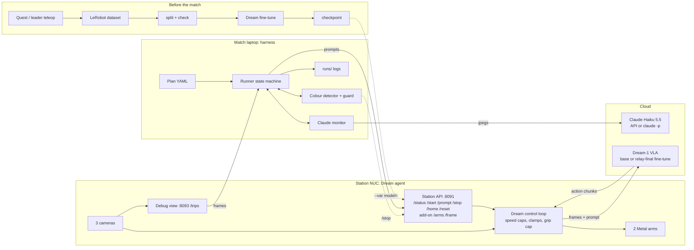
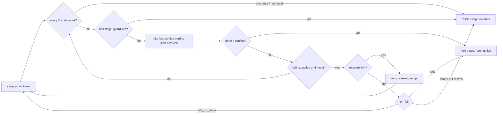

# How the Hill Climb harness works

_Written 8 Nov 2026 from all branches of this repo and `darshp848/task_simulation`. Also published as a page with a drawn diagram, and as [Hill_Climb_Harness_Explained.pdf](Hill_Climb_Harness_Explained.pdf)._

The harness is a supervisor that runs on the match laptop. It never drives a motor. It gives Dream-1 one short prompt per stage through Dream's own station agent, watches the cameras with a Claude vision monitor and a local colour detector, decides when a stage is done or failing, and recovers, moves on or stops. Every decision is logged with the frames it was made on.

Read from `darshp848/hill-climb-harness` (all 14 branches, `main` at `9db93f6`, `cloud-sims` at `0c34f62`) and `darshp848/task_simulation` (`60d6846`), 8 Nov 17:30 UTC. Code paths are on `main` unless marked *\[cloud-sims\]*.

## Big picture

There are three machines. The **match laptop** runs the harness (`python -m harness plans/hill_climb_v4.yaml --live`). The **station NUC** (`nuck-5`) runs Dream's agent, `dreamcli robot up --view-port 8093`, which owns the two Metal arms, the three cameras and every safety limit. The **cloud** holds Dream-1, which turns camera frames and a prompt into action chunks, and Claude, which the monitor asks about the frames.

The harness talks to the station only over HTTP on `127.0.0.1:8091` (control) and `:8093` (frames). The only module that can make an arm move is `harness/station_client.py`, and it does that only by asking the agent to start, change prompt, stop, home or reset.



Dashed arrows: the guard's emergency `/stop`, and the fine-tune checkpoint chosen before the match. The live guard and `/frame` add-on route are on `cloud-sims`.

## The match: four stages in 295 seconds

The match plan is `plans/hill_climb_v4.yaml`, written for rubric v4. Points: the first cable out is +10 and passes Stage 1, each further cable +5; a tower over 4 in that stands 3 s after release is +20, then +3 per full inch (+10 for the taller tower on Sunday); each golf ball in our bin +5. A black 8-ball in the bin loses the match, and on our table Darsh ruled the **white** ball illegal too. Touching a later stage's objects before the current pass bar is met is a DQ, and so is any human input after "go". There is no time bonus, so the plan uses the whole clock (`time_budget_s: 295`).

Plug-in stages were dropped on 7 Nov at 17:50: base Dream-1 never seated a plug, and no teleop demo completed one.

| Stage (in order)                    | Prompt sent to Dream-1                                                              | Timeout    | Tries | If it fails                                                     | Confirm |
|-------------------------------------|-------------------------------------------------------------------------------------|------------|-------|-----------------------------------------------------------------|---------|
| `unplug_cable` *\[pass bar\]*       | unplug the USB cable at the end of the hub nearest the right arm                    | 60 s       | 99    | retry in place, recoveries keep_pulling ×4 / let_go_and_lift ×3 | 2       |
| `put_cable_down`                    | put the held cable down on the table away from the hub                              | 20 s       | 1     | skip                                                            | 1       |
| `release_cable`                     | open both grippers and move the arms up                                             | 10 s       | 1     | skip                                                            | 1       |
| `unplug_more` *\[+5\]*              | same text as unplug_cable                                                           | 20 s       | 1     | skip                                                            | 2       |
| `put_more_down`, `arms_clear`       | put-down text, then open-and-lift text                                              | 12 s, 10 s | 1     | skip                                                            | 1       |
| `stack_2`, `stack_3` *\[pass bar\]* | put a block on top of the stack                                                     | 40 s       | 99    | retry in place, keep_going / let_go_and_lift                    | 2       |
| `tower_pass` *\[pass bar\]*         | put a block on top of the stack (skipped at once if the tower is already over 4 in) | 40 s       | 99    | retry in place                                                  | 2       |
| `higher_1`, `higher_2`              | put a block on top of the stack                                                     | 30 s       | 1     | skip                                                            | 1       |
| `ball_1` … `ball_8` *\[guarded\]*   | put a golf ball in the bin                                                          | 25 s       | 1     | skip                                                            | 1       |

Pass-bar stages never skip, because moving on means touching the next stage's objects. They retry until the clock runs out. With `tower_prompts` set (base Dream-1 only), the stack stages instead name the next piece, for example "put the cube on top of the stack".

## Inside one stage

The first stage starts the run with `/start`. Each later stage swaps the prompt live with `/prompt`, so the arms never stop between stages. Then `Runner._watch` loops every `check_every_s` (3 s):

1.  **Health.** `GET /status`. A dead arm ends the run. State `error` goes to the fault rules in the next section. Going idle ends the attempt.
2.  **Local guard** (ball stages, with `--detect`): the colour detector looks at the wrist frames. A yes stops the run at once.
3.  **Ask the verifier** once `max(min_run_s, settle_s)` has passed. The monitor answers with the result of its previous call and starts the next one in the background, so the loop never waits for Claude.
4.  **Decide.**
    - *Done:* `confirm` "done" looks in a row, or two within 15 s (`DONE_WINDOW_S`) even with a flicker between. The same frames judged twice count once, so a frozen camera can't confirm. Monitor "done" needs confidence ≥ 0.7.
    - *Failing:* `confirm` failing looks, and only after half the timeout (`FAIL_MIN_FRACTION`). A progress drop of 0.3 below the attempt's best counts as failing.
    - *Stalled:* progress hasn't risen 0.05 in `stall_s` (20 s), or the monitor says "stalled" twice.
    - *Timeout:* if a "done" is waiting for its confirming look, 10 s grace. If the gripper holds the target with progress ≥ 0.5, one 20 s extension.
5.  **On a failed attempt** it picks a recovery from the stage's menu: the monitor's suggestion if it has uses left, else the next unused one, never the same one twice in a row. A `retry` re-sends the stage prompt. A `reset` sends its own prompt (for example "open both grippers and move the arms up"), waits up to `min(timeout/2, 20 s)` for the monitor's `scene_ok`, then re-sends the stage prompt. When the menu is used up, `on_fail` decides: `retry_in_place`, `home_and_retry` (stop, home, start), `skip` or `abort`.



The run ends on the last stage, the 295 s budget, Ctrl+C, `s` + Enter, SIGTERM, or a guard trip. Each of these sends `POST /stop`, so the arms hold where they are. The harness never homes at the end. Before anything starts, preflight refuses a station that isn't idle, has a dead arm, or has a camera older than 2 s.

## How Dream-1 is called

### Routes

- `POST /start {prompt, checkpoint}` starts a run. The checkpoint is `dreamlabs/dream-1-beta` by default, or the fine-tune via `--var model=dream-1-ft:bb4b9e5f-relay-final` on main.
- `POST /prompt` changes the instruction while running.
- `/stop`, `/home`, `/reset`. `--dry-run` sends no POST at all and prints what it would send.
- Frames: `/trips` on 8093 on main (about 2 MB a round trip). On cloud-sims, `/frame/<cam>.jpg?w=640` (about 35 KB) from the station add-on, which brought Dream's round trip from 2–6 s down to about 0.8 s.
- Gripper sensors: `GET /arms` tells the monitor "closed fully on nothing" from "stopped partway: holding something".

### Errors and retries

- **Refusal** (`DA-4000 … unsafe instruction`): restart the same prompt once, then fail that attempt but keep the match going.
- **Transient** (gateway `DA-5000/6000`, `DA-0001` session replaced, empty action buffer, `SVD did not converge`): restart with the same prompt, up to 5 times a run. On cloud-sims an SVD error is first cleared with `/reset` (at most 2).
- **Anything else** (an arm, a motor, a safety stop): never retried. The run stops.
- Credits running out shows up as `DA-1000 UNAUTHORIZED (disabled)`, which reads like a revoked key. The harness treats it as a hard error. The "check Dream once before a batch" step asked for at 14:57 is not built yet.

Station numbers, 1650 calls on 7–8 Nov: round trip median 1115 ms, 90th percentile 2732 ms, worst 8655 ms. Most of that is Dream's gateway; the model itself is about 293 ms.

## The Claude monitor

Stages use `verifier: monitor`. It's the `MonitorVerifier` class in `harness/verifiers.py`, set in the plan as `claude: {model: claude-haiku-5-5, max_tokens: 4000, history_frames: 6}`. It needs 4000 tokens because Haiku 5.5 thinks before it answers; 600 cut off every reply. Each call sends:

- the overhead view's frame from the stage start, up to 6 earlier frames, and the newest one, all with time labels, plus the newest wrist frames;
- the whole plan with the current stage marked, the stage's yes/no question, an "expect" line describing correct behaviour, camera notes, the gripper sensor reading, time left, the last prompt sent, and the recovery menu;
- on ball stages, the guard question; on stack stages, the target tower to report back.

It answers in JSON: `stage_done, progress 0–1, status ok|stalled|failing, holding {left,right}, recovery, scene_ok, confidence`, plus `guard` and `tower` where asked. Only one call is in flight at a time. An answer computed before a prompt or stage change is dropped, except a guard "yes", which still counts. Bad JPEGs are filtered out, because one would make the API reject the whole request.

**Backends:** `api` (`ANTHROPIC_API_KEY`), or `--claude-backend subscription`, which pipes the same request through `claude -p` with no tools. Measured on 7 Nov: 12/12 right on known photos, median 8.4 s, max 12.7 s a call. On *\[cloud-sims\]*, a stitched grid of earlier frames plus two calls in flight (`parallel: 2`) gives a verdict about every 4.9 s instead of 9.7 s, and OpenRouter judges are an option. In the 60-decision benchmark, GPT-6.1 Terra was 98–100% right at 2.8–3.7 s.

**Rules check.** Whether an outside model may judge for the harness is still marked as a question for the organizers in the guide.

## The illegal-ball guard

The `guard:` block covers every stage whose name starts with `ball_`. On each ball check the monitor also answers: "Is either gripper holding the white ball or a black 8-ball (balls that must never go in the bin), or closed or closing around one?" A single yes (`confirm: 1`) raises `_Guard`. That sends `POST /stop`, which leaves the ball held in the gripper and out of the bin, and the CLI prints `ILLEGAL BALL HELD: RUN STOPPED. CALL STOP NOW` for the person who calls stop. If there has been no guard answer for 20 s (`max_blind_s`), for example because the API is down, it stops too: nobody would be watching for a black ball.

There are three ways the guard can say yes, from slow to fast:

1.  the monitor's `guard` field, 6.5–13 s old by the time it lands;
2.  the local detector on every 3 s poll (`--detect plans/table_colors.yaml`), which takes milliseconds and works offline;
3.  *\[cloud-sims\]* the live guard (`--live-guard`): its own thread at 10 Hz on `/frame/<wrist>.jpg`. Three yes frames in a row send `/stop` by themselves. While it is armed, `/home` and `/reset` are blocked.

In the 185-match stress run, a fast judge without the live guard lost 28 matches to an illegal ball, and the merged config with the live guard lost none.

## The local colour detector

`harness/detect.py` uses only numpy, Pillow and scipy. It shrinks each frame to 640 px, converts it to HSV, thresholds each colour class from `plans/table_colors.yaml`, labels blobs, and sorts each blob by shape into ball (round), cube (compact) or stick (long and thin). Each colour lists which shapes count and what role they have: *avoid* (white ball, black ball), *target* (green, orange and yellow balls) or *info* (blocks and sticks). Black lists only the ball shape, so the black gripper fingers are never reported.

- **Guard:** an avoid ball inside the wrist image's grip region (x 0.25–0.75, y 0.35–1.0) of at least 1% of the image counts as held.
- **Boxes:** it draws labelled boxes on the frames the monitor sees and adds a legend, so Claude counts marked objects instead of guessing. Dream-1's own input is never changed.
- **Overhead view:** anything above 32% of the image height (people, laptops) is ignored.

The colours were tuned on a phone photo of station C (IMG_2698), not on the station's own cameras, and there is no photo of a black 8-ball. Re-tune before a match with `python -m harness.detect plans/table_colors.yaml frame.jpg --out boxed.jpg`. On *\[cloud-sims\]* a small CNN (`models/cable_end.onnx`) also boxes the USB-C and USB-A cable ends. The `mac-arm64` branch has a 3–5x faster detector that gives the same output, checked against real wrist frames.

## The plan file

A plan is YAML, validated before anything runs. A bad field is rejected with the stage and field named. The fields that matter in v4:

| Field                            | v4 value                                                                                                                                 | What it does                                                                                                                                             |
|----------------------------------|------------------------------------------------------------------------------------------------------------------------------------------|----------------------------------------------------------------------------------------------------------------------------------------------------------|
| `checkpoint`                     | `"{model}"`, var default `dreamlabs/dream-1-beta`                                                                                        | Model for `/start`. Pass `--var model=dream-1-ft:…` for the fine-tune. On cloud-sims it is hard-coded to base; use `--checkpoint` instead.               |
| `time_budget_s`, `check_every_s` | 295, 3.0                                                                                                                                 | Whole-run clock and poll period.                                                                                                                         |
| `verifier`, `confirm`            | monitor, 2                                                                                                                               | Default judge and number of agreeing looks. Stages can override both.                                                                                    |
| `claude`                         | haiku-5-5, 4000 tokens, 6 history frames                                                                                                 | Monitor settings. cloud-sims: 4 frames, `stitch: true`, `parallel: 2`.                                                                                   |
| `guard`                          | question, `stages: [ball_]`, confirm 1, max_blind_s 20                                                                                   | Safety question that stops the run on a yes.                                                                                                             |
| `tower_target`                   | 3 cubes then 2 upright sticks                                                                                                            | Expected tower. The monitor reports what it sees and `tower_order_ok` is logged, but it never gates a stage. Colour order doesn't matter (Darsh, 8 Nov). |
| `tower_prompts`                  | `put the <piece> on top of the stack`                                                                                                    | Names the next piece, for base Dream-1. Delete it for a fine-tune, which only knows its recorded text.                                                   |
| stage fields                     | `prompt, success, expect, timeout_s, max_attempts, min_run_s, settle_s, stall_s, recovery, on_fail, skip_if_done, camera_notes`          | Per-stage behaviour, as above. `skip_unless`, `watch`, `cameras` and `history_cameras` also exist.                                                       |
| *\[cloud-sims\]* only            | `operator_notes, prompt_technique, start_pose, rewrite_prompts, prompt_prefix, reset_first, requires_stage, confirm_gap_s, decide, fast` | Darsh's decisions, the start-pose gate, monitor-written prompts and so on. Explained in the branch section.                                              |

CLI: `python -m harness PLAN (--dry-run | --live | --mock) [--detect COLORS] [--verifier …] [--claude-backend api|subscription] [--var NAME=VALUE]`. cloud-sims adds `--match --live-guard --skip --checkpoint --no-rewrite --cable-ends --joints`.

## Teleop and the fine-tune

Teleop is not used in a match, since any human input after "go" is a DQ. It is how the fine-tune got its data. `TELEOP_PLAN.md` is the recording plan. Each take is recorded under one exact task text with a Meta Quest or the leader arm (`darshp848/follower_code`, branch `quest-continuity`) and lands in a LeRobot dataset on the NUC. The 7 Nov decision was to put the fine-tune on **unplug (T1)** and **put-down (T2)** only, because unplugging is the Stage 1 pass bar and base Dream-1 manages it about 1 try in 6. Stacking and balls stay on base skill. The fine-tune mixes in Dream's own data (`base_share` 0.5).

Long takes are cut into one episode per sub-task with `tools/auto_split.py` (it proposes cuts from the right gripper's grasps) and `tools/split_episodes.py`. All 42 takes were checked: 70 unplug, 52 put-down, 15 plug-in, 11 upright stick, 12 ball and 4 block episodes. `tools/check_dataset.py` and `tools/finetune_watch.py` (main only) check the data and watch the job. Main says fine-tune `relay-final` is ready.

A fine-tune follows only the texts it was trained on, so every v4 prompt is one of the recorded texts, byte for byte. Check before a run:

```bash
python -m harness.tasks plans/hill_climb_v4.yaml ~/hackathon_data/unplug-v1 ~/hackathon_data/relay-v1
```

The stack, ball and open-gripper texts show as MISSING there, which is expected: those stages run on base skill.

## Simulators and stress tests

| Tool                                                 | What it is                                                                                                                                                                            | What it tells you                                                                                                         |
|------------------------------------------------------|---------------------------------------------------------------------------------------------------------------------------------------------------------------------------------------|---------------------------------------------------------------------------------------------------------------------------|
| `fake_station.py` (`--mock`)                         | An HTTP stand-in with Dream's real state machine and scenarios: happy, arm_dies, start_error, slow_start, camera_stale                                                                | Harness logic and the safety stops, no network needed                                                                     |
| `experiments/stress_match.py`                        | Whole matches on a virtual clock (5 min in about 1 s). The real Runner and monitor code, with a rule-based table and policy, and faults taken from the NUC logs                       | 37 scenarios × 5 seeds. Mean points and losses per config. It's scripted, so it can't tell you if a robot can do the task |
| `live_stress.py`, `sweep_variants.py`                | Watch a stress match in the browser at 10x, and A/B harness constants or plan edits on the same seeds and latencies                                                                   | Tuning, for example dropping three entry checks: 54.9 → 60.0 points                                                       |
| `sim_station.py` + `sim_scenes/hill_climb_table.py`  | Dream's own MuJoCo YAM sim with the relay table and a rubric v4 referee, served on the same ports as the station                                                                      | The real Dream-1 on a simulated table. `--policy scripted` runs offline                                                   |
| `experiments/sim_match.py`, `cluster/run_matches.sh` | Full matches in the MuJoCo sim with an oracle verifier (ground truth), in parallel Docker workers on the lab cluster                                                                  | 25 matches: a cable came out in 14, put-down 0/54, stack 0/25, balls never reached                                        |
| *\[cloud-sims\]* `cloud/`                            | Google Cloud Batch: a 1,000-match matrix (v4 against hybrid), one fresh sim per match, uploads to `gs://hill-climb-sims-results`. Everything is a dry run unless you pass `--execute` | Round 1 died at 12:05 UTC when Dream credits ran out. Only 10/28 matches were valid, so don't draw conclusions from it    |

Sim-to-real caution: the MuJoCo arms are YAM, not Metal, and the Hill Climb track runs on Metal arms. The table layout is an estimate from photos.

## Tests

Run them with `python -m pytest -q`. You need `numpy pillow pyyaml scipy pytest`. On cloud-sims, `psutil` and `opencv-python-headless` too, or two test files fail to import. Tests that need MuJoCo or the `dreamlabs` package skip themselves.

- **main**, 22 test files, run here at 17:45 UTC: **231 passed, 4 skipped** in 3 min 36 s.
- **cloud-sims**, 35 test files: run here at 17:50 UTC with `psutil` and `opencv` installed: **373 passed, 5 failed, 10 skipped** in 5 min 39 s. All 5 failures are in `test_async_pacing.py`, and they fail only because that file needs Dream's `yam_mujoco` example (the `dreamlabs` package) and, unlike the other sim tests, doesn't skip itself when it's missing. They tell you nothing about the harness logic. The 13:07 UTC run had failures in `test_cli_transport` and `test_backend_switch`; those now pass.

What they cover: `test_runner` and `test_v2` (the state machine: confirm, regression, stall, grace, recoveries), `test_stress` (whole matches per fault scenario), `test_guard` and `test_tower_target`, `test_detect` (the detector on the real station C photo), `test_fake_station` and `test_sim_station`, `test_match_plans` (the v4 plan obeys the DQ rules), `test_claude_cli` (the subscription backend sends the request unchanged), plus the dataset and tool tests.

## All 14 branches

Most branches build on each other. Branches lower in the table contain the ones above them unless noted. "Ahead/behind" counts commits against `main`.

| Branch                                                                                            | Ahead / behind | What only it has                                                                                                                                                                                                                                                                | Status                                                           |
|---------------------------------------------------------------------------------------------------|----------------|---------------------------------------------------------------------------------------------------------------------------------------------------------------------------------------------------------------------------------------------------------------------------------|------------------------------------------------------------------|
| `main`                                                                                            | 0 / 0          | The core above, the 7–8 Nov report, fine-tune `relay-final` tooling (`check_dataset`, `finetune_watch`, cable A/B bench), tower shapes only                                                                                                                                     | Default branch                                                   |
| `stress-test-fixes`                                                                               | 0 / 11         | Nothing, fully merged into main                                                                                                                                                                                                                                                 | Can be deleted                                                   |
| `codex/watcher-dimos` → `dual-arm-experiment`, `hill-climb-review-fixes` → `hill-climb-sim-table` | 1–15 / 26      | Codex's 7 Nov afternoon chain, based on old main. Their ideas (watcher, DimOS skills, sim table, fault restarts, dual-arm bench) were re-landed on main as separate commits. Left only here: `MATCH_DESIGN.md`, v2 plans `hill_climb_full/sprint`, three match-supervisor tests | Superseded. The LiveKit observer was ported to final-harness     |
| `tools/episode-review-page`                                                                       | 7 / 9          | `tools/review_page.py`: a page to review teleop episodes side by side and keep or drop them                                                                                                                                                                                     | Not merged. Useful for data cleaning                             |
| `hybrid-harness` (kaupau)                                                                         | 12 / 8         | `plans/hybrid_v4.yaml` for base Dream-1: colour and position prompts, monitor-written prompt rewrites, `reset_first`, light frames, gripper sensors, `requires_stage`, operator console, fixes from station runs 1–3                                                            | Merged into final-harness                                        |
| `start-pose-live-guard`                                                                           | 10 / 8         | The 10 Hz live guard, the start-pose gate (home before unplug if the pose is unfamiliar), the cable-end CNN, `decide.py` in shadow mode                                                                                                                                         | Merged into final-harness                                        |
| `final-harness`                                                                                   | 30 / 5         | main + the two above + LiveKit observer + `--match` (refuses human verifiers and the operator console) + `/reset` through the motion checks + `FINAL_HARNESS.md`. Last commit: Darsh's `docs/decisions.pdf` and `DECISIONS.md`                                                  | Its decisions commit is in no other branch                       |
| `hedged-calls`                                                                                    | 34 / 5         | final-harness (without decisions) + hedged calls, the 20 Hz fast loop with a state-space observer, layered prompts (`promptgen`), OpenRouter judges and the judge benchmark                                                                                                     | Mostly in cloud-sims, except the last fix (`bench_judges` costs) |
| `mac-arm64`                                                                                       | 38 / 5         | hedged-calls + Apple Silicon setup, the 3–5x faster detector with golden wrist-frame tests, macOS CI                                                                                                                                                                            | Not in cloud-sims                                                |
| `cloud-sims`                                                                                      | 58 / 5         | hedged-calls + Darsh's operator notes (`operator_notes.yaml`: technique, watch_for, the 2-try/3-try rule, `ball_push_white`), Dream async at 2 Hz in the sim, GCP Batch, a sim table like the real one, live joint telemetry, joint observer and learned fault detector         | The candidate match branch. Missing main's last 5 commits        |

### main against cloud-sims, for the match

| Behaviour                           | main                                                           | cloud-sims                                                                                          |
|-------------------------------------|----------------------------------------------------------------|-----------------------------------------------------------------------------------------------------|
| Fine-tune checkpoint                | `--var model=dream-1-ft:bb4b9e5f-relay-final`                  | Base hard-coded in the plan; pass `--checkpoint`                                                    |
| Illegal-ball stop speed             | Monitor plus local detector every 3 s                          | Plus the 10 Hz live guard (`--live-guard`)                                                          |
| Monitor cadence                     | One call in flight, about 9.7 s a verdict                      | Stitched grid, two in flight, about 4.9 s                                                           |
| Frames                              | Debug-view trips (about 2 MB)                                  | `/frame` add-on (about 35 KB), debug view as fallback                                               |
| "Fail twice, move on"               | No: one try on skip stages                                     | 2 tries, 3 on stages worth 20+ points. Pass bars still retry                                        |
| Push the white ball off             | No                                                             | Only in `hybrid_v4` (needs `prompt_technique: true`), not in `hill_climb_v4`. Untested on the robot |
| Last cube hole up                   | No                                                             | `tower_target_last_cube`                                                                            |
| Start pose, `--match` safety checks | No                                                             | Yes                                                                                                 |
| MuJoCo table balls                  | White balls are the legal ones, which contradicts the v4 guard | Coloured legal, white and black illegal, like the real table                                        |
| Report and dataset tools            | `LAST_NIGHT` report, `check_dataset`, `finetune_watch`         | Missing                                                                                             |

## Open problems worth knowing

**No real-table success data yet.** 52 policy runs on the station logged no per-stage outcome. Every points figure above comes from simulation. Before tuning anything else, run the match plan on the real table and log each stage.

- **Pick the match branch.** If it's cloud-sims, merge main into it first: it lacks main's last 5 commits, including the fine-tune checkpoint var and the dataset tools. Pull in final-harness's `decisions.pdf` and mac-arm64's detector if you want them.
- **A false "cable out" caused a DQ in the sim** when two calls were in flight. `confirm_gap_s` exists on cloud-sims but no plan sets it, so it is 0.
- **Detector colours** come from a phone photo, and there is no black 8-ball photo. Re-tune on the station's cameras.
- **Stale text:** HARNESS_GUIDE still lists plug-in stages for v4 and prints "BLACK BALL HELD". `cloud/README.md` still says white balls are targets in the sim, which `run.py` no longer does.
- **Grip strength:** 1.5 N·m now. Going to 2.0 N·m is a manual step (`docs/STATION_TOMORROW.md`), and the gripper latches off at 55 °C.
