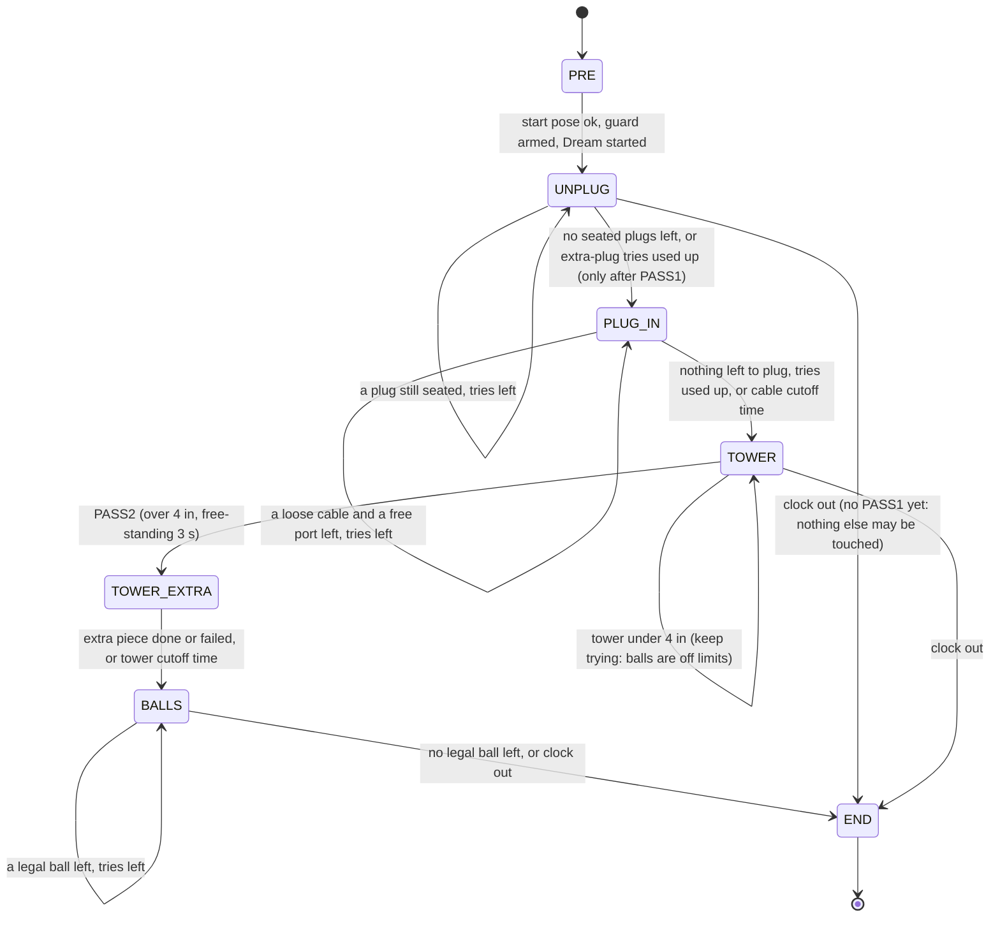

# Match state machine for the prompt engine (draft, 8 Nov)

The order comes from Darsh's decisions (`docs/decisions.pdf` on `final-harness`, and `G:\My Drive\decisions.pdf`):

1. unplug every cable that starts plugged in;
2. plug the loose USB cables into free ports;
3. build the tower;
4. put the golf balls in the bin.

The rules come from rubric v4.

**Built (sim plan `plans/relay_sm_sim.yaml`):**
- The stage order above.
- Per-try template `variants`.
- `on_fail: retry_then_skip` (the two- or three-try rule).
- `not_after_s` cutoffs.
- Plug-in templates and their sim oracle slots.

**Not built:** the harness insert skill, the real-table port and cable classifier slots, and a Claude filler prompt for plug-in.

## 1. Top level



| State | Pass bar / points (rubric v4) | Tries ("fails more than twice, move on; three if worth a lot") | Leaves when |
|---|---|---|---|
| PRE | none | 1 | `reset_first`, start-pose gate, live guard armed |
| UNPLUG, first plug | **PASS1**, +10 | unlimited: touching blocks before PASS1 is a DQ | the seated-plug count drops by one, two looks agree |
| UNPLUG, each further plug | +5 | 2 per plug | no seated plugs left, or the tries are used up |
| PLUG_IN, each loose cable | +20 (up to 4) | 3 per cable (≥ 20 points) | no loose cable from t0 left, no free port, or the cable cutoff time |
| TOWER, to 4 in | **PASS2**, +20 | unlimited: touching balls before PASS2 is a DQ | over 4 in and free-standing 3 s after release, two looks |
| TOWER_EXTRA | +3 per full inch | 2 per piece | one piece more, or the tower cutoff time |
| BALLS, each ball | +5 | 2 per ball | no legal ball left, or the clock runs out |
| END | none | none | `/stop`, done message |

Darsh's two-try rule can't apply before a pass bar, because moving on there is a DQ. Those states keep going until the clock runs out (this matches `plans/operator_notes.yaml` on `fix/guard-real-frames`).

**Cutoff times.** Plug-ins are worth the most (up to 80) but have never worked on base Dream-1: the v4 plan dropped plug-in on 7 Nov because Dream never seated a plug. The tower's +20 and the inches come later and are still needed. So PLUG_IN gets a hard cutoff (start value: leave by t = 150 s). TOWER_EXTRA leaves by t = 230 s, so the balls get their time. Sim runs should set both values (`decide.py`'s `W(L)`), not a guess.

## 2. Inside each state

Each work state loops over **targets**. A target is one plug, one loose cable, one tower piece or one ball. Each target goes through the same steps:

```
SELECT target from the world estimate
  -> PROMPT  (compose from template + slots for this target and attempt)
  -> RUN     (Dream works; monitor + sensors watch; hands_off: no mid-attempt nagging)
  -> SKILL?  (harness motion where tested: regrip / pull / insert)
  -> VERIFY  (two agreeing looks + sensor; pass bars add the dwell)
  -> CLEANUP (put the cable down / open and lift)
  -> next target, or retry the same target with the next prompt variant, or give up on it
```

### UNPLUG
- **World:** seated plugs (cable-end classifier plus monitor count), which one is nearest the right arm.
- **Steps:**
  1. Approach and grip, with Dream's prompt.
  2. **Regrip skill** if Dream shut on nothing (`grip_assist` on `claude/harness-stitch`, 2/2 on the bot).
  3. **Pull skill** straight up, 6 + 4 cm.
  4. Verify: the seated count dropped.
  5. Put down: lay the cable flat next to the strip, away from the ports.
- **Darsh's notes:** come in normal to the cable, grip at full strength, pull vertical. The harness pull and 20 N pull force do this better than words; the hand tests showed direction words don't change Dream's pull.
- "Grip 2-3 cables at once" is untested. It stays a variant behind a flag and is not the default.

### PLUG_IN (new)
- **World:** the cables loose **at t0**, recorded at PRE. A cable we unplugged may never go back in; that is a rubric rule. Also the free ports, counted from the left.
- **Steps:**
  1. Pick: Dream takes the connector by its black body, from above.
  2. Align over the first free port from the left.
  3. **Insert skill:** the arm moves straight down (the pull skill in reverse).
  4. Verify seated: the port is occupied and the cable holds when the gripper opens.
  5. Release and lift.
- **Open question:** the real strip has no USB-C ports; per `USBC_PORT_CLASSIFIER_PLAN.md` the bank is four USB-A ports. So the USB-A end goes in. The sim's referee accepts either end in a free port of its kind. Confirm with the operator before writing the templates.
- `plans/bot_v1.yaml` says "Never plug a cable in". That has to change for this order.

### TOWER
- **World:** the tower from the monitor (bottom to top), the height, which cubes and sticks are left.
- **Pieces:** cubes first, each set straight on the one below. The last cube goes hole up. Then the sticks stand vertical through the hole.
- **Prompts:** the hand tests say short "put the `<piece>` on top of `<top>`" prompts, no arm named, one piece per prompt. Whole-tower prompts never stacked.
- **Verify:** two looks plus the 3 s free-standing dwell after release. Drop `skip_if_done` on the pass stage (audit A02), and don't let a 15 s done window pass a re-placed tower (A03).

### BALLS
- **World:** the legal balls and their positions (detector plus homography), and where the illegal balls are.
- **Target choice:** the legal ball nearest the right arm and clear of the tower. The right arm does balls; the left arm knocked the white ball in the hand tests.
- **Prompt:** one ball per prompt, colour plus position.
- Darsh's "push the white ball off the table" is untested, and touching it risks the guard. It stays off by default and is tried only when the white ball blocks the only reachable legal ball. Sim first.
- **Live guard:** 10 Hz on throughout.

## 3. How the prompt changes with the state

The prompt is a function of the state, never free text:

`prompt = template[state, step, variant](slots(world, target))`

It changes whenever one of these inputs changes:

| What changed | What the prompt does | Example |
|---|---|---|
| The target | slots refill from the newest world estimate | "the cable still plugged in" → "the plug at the left end of the strip" once only that one is left |
| The step within a target | the next step's template | unplug → "Put the held cable down on the table to the right ..." |
| The tower | `<piece>` and `<top>` follow the tower | "put the blue cube on top of the pink cube" → "put the round stick into the hole of the top cube" |
| A failed try on the same target | the next tested variant, slots refilled (the object may have moved) | ball try 1 names its colour and side; try 2 names its new position, or picks the next nearest ball |
| The monitor says stalled or failing | the filler refills with the monitor's reason as a hint; the text is sent only if it changed | wrong cube picked → a slot names a different cube |
| A move to a new state | `prefetch` filled the first prompt of the next state while the last check ran | PASS1 → the first plug-in prompt is ready |

What stays on the harness side and never goes into Dream's prompt: the try number, "% done", why the last try failed, and the match goal. Those are levels 3-5 of `harness/promptgen.py` on `hedged-calls`. The hand tests found that long and coached prompts did worst (the 111-word cable prompt). They also found that negations put the wrong object in play. Variants are listed in the plan per state, and each wording is linted at load.

## 4. What comes from the other branches, checked

| Piece | Branch | Verdict |
|---|---|---|
| Pass-bar gating, `requires_stage`, `confirm: 2`, monitor verifier | main | keep |
| Live guard at 10 Hz, start-pose gate, stop on any exception (A01) | final-harness / main | keep |
| Grip assist: regrip, seat, pull, `min_z`, gripper-sensor hold band | claude/harness-stitch | keep; it's the only thing that unplugged 2/2 on the bot. Mirror it for the insert skill |
| `hands_off`: no recovery nagging mid-attempt | claude/harness-stitch | keep |
| Stitched judge, `parallel`, light frames, sensors overruling the monitor | hybrid-harness | keep |
| Cable-end classifier | start-pose-live-guard | keep, for the seated count |
| Darsh's attempt rule (2, or 3 at ≥ 20 points; pass bars exempt) | fix/guard-real-frames `operator_notes.yaml` | keep |
| Operator `technique` text added to Dream's prompt | fix/guard-real-frames | **don't send it to Dream** (long coached prompts failed); use it as the monitor's `watch_for` |
| `promptgen` levels 2-5 | hedged-calls | levels 2-5 stay off Dream's prompt; only the slot content can change |
| Monitor-written `next_prompt` free text | hybrid / bot-prompt-writer | replaced by refills; log it only |
| `ball_push_white` stage | fix/guard-real-frames | off by default, sim first |
| `decide.py` making decisions | start-pose-live-guard | shadow only; use it to set the cutoff times |
| `tower_pass` `skip_if_done`, the 15 s done window | main | fix (A02, A03) before using the tower states |
| "Never plug a cable in" | bot_v1.yaml | drop |
| Joint fault encoder, EEF override, mac-arm64, cloud runner | other branches | not part of the state machine |

## 5. Testing it

The sim table on `prompt-engine` has 2 plugged and 2 loose cables, and its referee scores plug-ins. So the whole order runs there:
- `OracleFiller` needs a plug-in slot (loose cable from t0, first free port).
- The sim has no `/move`, so the regrip, pull and insert skills can't be simulated. In the sim, Dream alone does PLUG_IN and the numbers are a lower bound.
