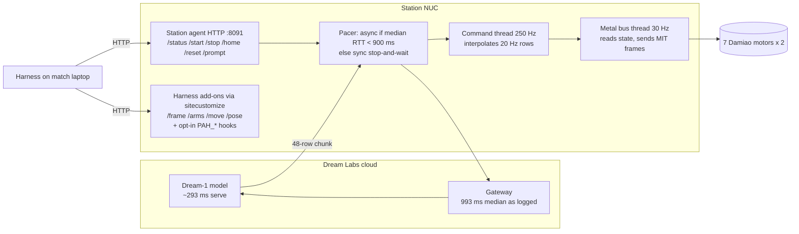

# 1. Task, rubric v4, scoring and the station

[Back to the index](../TECHNICAL_REPORT.md)

## 1.1 The event

Physical AI Hacks (MakerMods × Dream Labs), 7–8 Nov 2026. The team (Daniel Carrera, David Carrera, Kaushik Kanna,
Muhammad Mukthar, Darsh Patel) entered the **Hill Climb** track: a timed, five-minute, 1v1 relay on a two-arm
MakerMods Metal station driven by Dream Labs' hosted **Dream-1** vision-language-action (VLA) policy. No human input
is allowed after "go". The only controls a team has are the words sent to the policy, when to stop, home or reset
the arms, and (offline) the data used for a fine-tune.

Sources: rubric table in the paper (`task_simulation@paper:paper/main.tex:125-142`), the plans' `task:` texts
(`plans/bot_v1.yaml:30-35`), `docs/STATE_MACHINE.md`, and `docs/DECISIONS.md` on `final-harness`.

## 1.2 Rubric v4 (abridged)

| Stage | Pass bar | Points |
|---|---|---|
| 1. Unplug USB cables | ≥ 1 cable out of the strip | +10 first, +5 each further; +20 per loose cable plugged in (max 4) |
| 2. Stack | tower > 4 in (10.2 cm), free-standing 3 s after release | +20; +3 per full inch; +10 for the taller tower (head-to-head) |
| 3. Golf balls | none | +5 per legal ball in the bin; **illegal ball in the bin = match lost** |
| Integrations | shown to the referee before the match | +10 LiveKit, +5 Dimensional (DimOS) |

Disqualification: touching a later stage's object before the current pass bar is met; any human input after "go".

Two properties of this rubric shaped the whole design:

1. **Gates are irreversible.** A false "stage done" on a pass bar makes the harness move on, and touching a block
   before a cable is out is a DQ. A supervisor false positive is therefore worse than a supervisor false negative.
2. **One illegal ball loses everything.** On the team's table the **white** golf ball is illegal and the green, yellow and
   orange balls are legal (Darsh, 8 Nov; `plans/table_colors.yaml` header). The rubric also mentions black 8-balls;
   the harness guards against both. In the MuJoCo sim the colours were at first reversed (white legal, black
   8-ball illegal), which matters when reading sim results (§6).

**Target tower** (Drive photo IMG_2697, encoded as `tower_target` in `plans/hill_climb_v4.yaml`): bottom to top,
blue cube, pink cube, blue cube with its hole sideways, yellow square stick upright, pink round stick upright.
On 8 Nov Darsh declared that **colour order does not matter** (commit 9db93f6; `runner.tower_matches`,
`harness/runner.py:113-118`, compares shapes only). The final bot plan stacks four cubes and ignores the sticks
(`plans/bot_v1.yaml:136-183`).

**Plug-in stages were dropped on 7 Nov** (base Dream-1 never seated a plug; `TELEOP_PLAN.md:9-10`). They come back
only in the relay state machine draft (`docs/STATE_MACHINE.md`, `plans/relay_sm_sim.yaml` on `prompt-engine`).

## 1.3 Station hardware

| Item | Value | Source |
|---|---|---|
| Arms | Two **MakerMods Metal** arms, 6 joints + gripper each, **7 Damiao motors per arm**, **no brakes**. Not i2rt YAM. | task_simulation `README.md` ("7 Damiao motors, brakeless, *not* YAM"); paper §3 |
| Bus | Damiao motors over CAN at 1 Mbit/s from an Intel NUC | `docs/STATION_TUNING.md` (station-tuning) |
| Cameras | Overhead `scene` on a centre pole, `wrist_l`, `wrist_r`; streamed at **640×360** (from 1280×720) | FT diagnosis "Ruled out" table; paper §3 |
| Table objects | Black 12-outlet power strip (ALESTOR, 25.7×9.7×3.0 cm) with a USB bank at the robot end; orange USB-A↔USB-C cables; three 6 cm foam cubes with a 2.8 cm through hole (two blue, one pink, later a green one appears in the bot plan); yellow 2×2×10 cm square stick; pink 2.5×11 cm round stick; green/yellow/orange (legal) and white (illegal) golf balls; white slotted basket | commit 9c89ae3 message; `plans/bot_v1.yaml` |
| Station SDK | `dreamlabs` **1.0.37** on the NUC (inspected read-only) | `docs/STATION_TUNING.md` |

## 1.4 Control stack (Dream-1 on the station)

| Layer | Rate | Notes |
|---|---|---|
| Policy chunk | 48 rows played at **20 Hz** = 2.4 s per chunk | `control_hz` 20; the fine-tune data has a nominal 30 fps timestamp rate ("20 Hz plays every plan at two thirds speed") |
| Command thread | 250 Hz (240 measured) | interpolates rows |
| Metal bus thread | **30 Hz, hard-coded** (`robots/metal.py ARM.tick_hz`) | so 7 of every 8 interpolated commands never reach a motor |
| Velocity feed-forward | low-pass `FF_ALPHA = 0.04` per tick ≈ **0.8 s** time constant | lags any motion shorter than ~1 s |
| Pacer | **async** (arm keeps moving during inference) only while the median round trip < **900 ms**; otherwise **sync** (wait for each chunk) | station.log `dream.pacing: pacing sync ... over the 900 ms threshold` |

All from `docs/STATION_TUNING.md` (branch `station-tuning`) and `docs/DECISION_MODEL.md` F1–F3 (branch `final-harness`).

### 1.4.1 Station HTTP API

The **station agent** (Dream's) serves, on `127.0.0.1:8091`: `/status`, `/start`, `/stop`, `/home`, `/reset`,
`/prompt`. One prompt drives **both** arms; there is no per-arm command and no way to run two sessions on one
station (`docs/DECISION_MODEL.md` §2).

The **station add-on** (`station_addons/sitecustomize.py`, loaded with `PYTHONPATH=.../station_addons dreamcli robot up`)
adds:

| Route | What | Used by |
|---|---|---|
| `GET /frame/<cam>.jpg[?w=640]` | newest controller frame, ~35 KB (vs ~2 MB debug-view trips) | light frames, live guard (`harness/live_guard.py:35-60`) |
| `GET /arms` | per gripper: measured opening, commanded opening, effort; joints | gripper-width rules (`harness/runner.py:506-530`) |
| `POST /move` | bounded relative Cartesian move of one arm, ≤ 12 cm per call (`MAX_MOVE_M`, `harness/plan.py:33`) | grip assist (regrip, pull, drop) |
| `GET /pose` | tool xyz per arm | grip assist `min_z`, pull Δz |
| `/objects` | **sim only**: ground-truth object poses | oracle verifier, referee |

`/move` and `/pose` came from Kaushik's `move_addon.py` (`extras/kaushik/station_addons/` on `kaushik/day1-extras`,
NUC copy under `nuc/pah_judge/` on `station-tuning`). Every add-on is off unless enabled, and the tuning hooks refuse
to load on any SDK other than 1.0.37 (`docs/STATION_TUNING.md`). The harness client is `harness/station_client.py`
(routes at lines 80-146; `/move` refuses > 12 cm at line 139).

### 1.4.2 Timing facts that shape the harness

- A camera frame from the debug view arrives every **3.4 s** median (`last-run.csv`), which set the original stage
  check windows (`harness/live_guard.py:3-4`).
- Dream round trip on the station: median **1,116 ms** over 1,650 chunks (verified, §7.1). Because that sits above
  the 900 ms pacer threshold, **66.7 %** of chunks (1,101/1,650) ran stop-and-wait.
- A fresh `/start` costs **2.9 s** (median) before motion, sometimes 7–12 s of discarded first answers; `/prompt` on
  a running session costs nothing extra (`DECISION_MODEL.md` F3; commit 86d039d).
- A fine-tune "cold start" took 3+ min, up to 15 min ("the policy is still starting…"; prompt-comparison replay).
