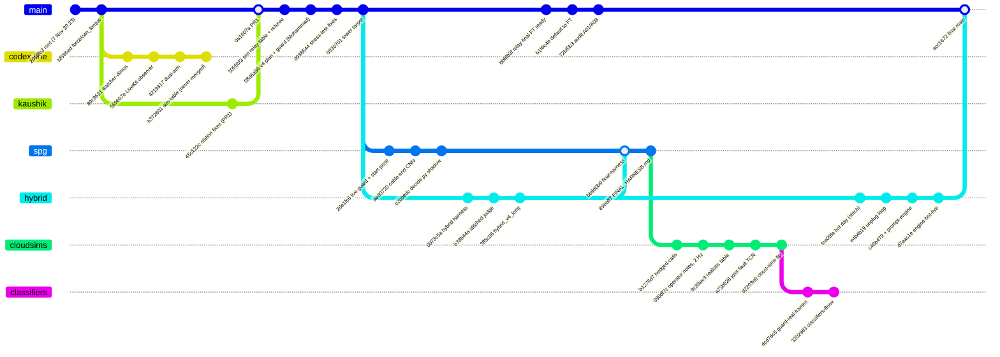

# 2. Repositories, branches and lineage

[Back to the index](../TECHNICAL_REPORT.md)

All times are **UTC**. Commit authors' local zones were −0600 (Darsh, Muhammad), −0800 (Kaushik, Daniel, David) and
+0000 (some Claude-authored commits), so `git log` dates mix zones; the tables below normalise them. Data from
`git for-each-ref`, `git log --graph --all`, `git merge-base` and the GitHub PR list, taken 9 Nov 2026 ~07:00 UTC.

## 2.1 The three repositories

| Repo | Branches | What it holds |
|---|---|---|
| `darshp848/hill-climb-harness` | 40 remote branches, 253 commits reachable | The harness that supervises Dream-1 on the station; station add-ons; stress sim; MuJoCo station stand-in; plans; cloud/cluster runners (on `cloud-sims`); classifiers (on the `cloud-sims` family); docs |
| `darshp848/task_simulation` | `main` (60d6846), `paper` (3ed22bf), `report-inputs` (6cc3224, pushed 07:09 UTC 9 Nov) | A synced copy of the harness at `main@f2f400e`, the 7–8 Nov **result files** (stress, judge bench, cloud round 1, cluster MuJoCo, station logs), plots, and the 16-page paper on `paper` |
| `darshp848/follower_code` | `main` (e87a17a), `quest-continuity` (8aa415d) | Teleop: i2rt YAM leader/follower (refuses unless `body: yam`), `metal/leader_collect.py` for Metal, `quest/quest_collect.py`; `quest-continuity` adds `WristFlipGuard`, `TrackingJumpGuard` and the replay bench |

`report-inputs` was **not** there when this work started and **appeared during it** (re-checked with
`git ls-remote` at the end, as the brief asked). It holds the local-only design docs, the Codex reports and three
Codex commits as patches; all of it is folded into this report, and §13.4 lists what each file added and what is
still missing.

## 2.2 hill-climb-harness: every remote branch

Status: **in main** = an ancestor of `main@acc1672`; **open PR** = has an unmerged PR; **ahead/behind** = commits
relative to `main`.

| Branch | Head | Last commit (UTC) | Author | Ahead / behind main | Status | What it is |
|---|---|---|---|---|---|---|
| `main` | acc1672 | 9 Nov 00:06 | darshp848 | 0 / 0 | final | Merge of `claude/engine-bot` (PR 9 LiveKit viewer) and `claude/engine-bot-live`; plan `bot_v1.yaml` on base Dream-1 |
| `claude/focused-lovelace-2z709x` | acc1672 | 9 Nov 00:06 | — | 0 / 0 | = main | Session branch of this report |
| `claude/engine-bot` | 3e8897b | 8 Nov 23:34 | kaushik kanna | 0 / 12 | in main | Bot harness + prompt engine plans (`plans/engine_bot.yaml`); merge of PR 9 |
| `claude/livekit-viewer` | 3805cca | 8 Nov 23:27 | kaupau | 0 / 13 | in main (PR 9) | View-only LiveKit camera card in the panel + standalone on :8098 (`harness/livekit_view.py`) |
| `claude/engine-bot-live` | d7aac1e | 9 Nov 00:18 | kaupau | 13 / 11 | **6 non-merge commits not in main** | Last bot fixes: orange-cable prompt, stacking option B, `confirm_every_s` (Sonnet re-checks the tower every 10 s) |
| `claude/engine-bot-local` | d7aac1e | 9 Nov 00:18 | kaupau | = engine-bot-live | duplicate ref | Same commit as `engine-bot-live` |
| `claude/harness-stitch` | 28336b0 | 9 Nov 00:18 | kaupau | 6 / 51 | open PR 5 (into `claude/bot-prompt-writer`) | "Bot day" harness: grip assist, `bot_v1.yaml`, hedged calls, live guard, `hands_off`, panel, success lock |
| `claude/bot-prompt-writer` | 21bad3a | 9 Nov 03:16 | kaupau | 1 / 75 | abandoned tip | `tools/full_run.sh` (all three tasks with the 8 Nov hand-tested prompts) on top of 7397826 |
| `relay-on-stitch` | f8771cd | 8 Nov 22:48 | darshp848 | 5 / 65 | open PR 8 (into `claude/harness-stitch`) | Prompt engine + relay state machine merged into the bot harness (`plans/bot_relay.yaml`); LiveKit observer token minting |
| `prompt-engine` | 3e7866c | 8 Nov 21:43 | darshp848 | 2 / 73 | merged into engine-bot via c46b479, tip not | Template engine (`harness/prompt_engine.py`), relay state machine (`plans/relay_sm_sim.yaml`), sim-time clock (`--clock sim`) |
| `hybrid-harness` | b5883e4 | 9 Nov 03:16 | kaupau | 1 / 88 | in main except tip | Kaushik's hybrid harness (monitor-written prompts, colour/position prompts, "no power" prefix, light frames, `label_rollout.py`); tip adds one operator lesson |
| `kaushik/cloud-sims-bot-plan` | faba96d | 9 Nov 03:16 | kaupau | 48 / 85 | abandoned | `plans/hill_climb_v4_bot.yaml` on top of `cloud-sims` |
| `claude/sim-hillclimb` | 400cbde | 9 Nov 03:17 | kaupau | 48 / 77 | abandoned | MuJoCo hill-climb fixes (no false cable passes, no early-touch DQs) + merge of `cloud-sims` |
| `kaushik/day1-extras` | 6365876 | 9 Nov 03:18 | kaupau | 1 / 0 | on top of main | `extras/kaushik/`: first harness, conductor, `/move` add-on, teleop dashboard patches, `v3_to_v21.py`, `trim_episodes.py` |
| `assets` | 54c8108 | 8 Nov 23:10 | kaupau | 1 / 123 | orphan-ish | PR 9 screenshots (not used here: may show people) |
| `final-harness` | 777e389 | 8 Nov 10:53 | darshp848 | 18 / 85 | superseded by `cloud-sims` | main(7 Nov) + `start-pose-live-guard` + `hybrid-harness`; guarded `/reset`, `--match`, stitched/parallel judge, `FINAL_HARNESS.md`, `docs/decisions.pdf` + `DECISIONS.md` |
| `start-pose-live-guard` | c2098dc | 8 Nov 06:52 | darshp848 | 10 / 100 | merged into final-harness | 10 Hz live guard, start-pose gate, cable-end classifier, `harness/decide.py` (shadow mode) |
| `hedged-calls` | bf33014 | 8 Nov 11:38 | darshp848 | 22 / 85 | merged into cloud-sims | `harness/hedge.py`, fast loop + state-space decisions (`statespace.py`), `promptgen.py` levels 0–5, OpenRouter judges, `tools/bench_judges.py` |
| `mac-arm64` | ad2a55f | 8 Nov 11:45 | darshp848 | 26 / 85 | abandoned (not merged) | 3.6× faster exact guard detector, `tools/mac_bench.py`, macOS CI, `requirements-match.txt`, `docs/LOCAL_DECISIONS_PERF.md` |
| `cloud-sims` | d2203e0 | 8 Nov 18:12 | darshp848 | 51 / 85 | not merged ("pick the match branch" was never resolved in its favour) | Everything from final-harness + hedged-calls, operator notes as plan data, async 2 Hz pacing, GCP Batch + home-cluster runners, **rebuilt realistic sim table (9c89ae3)**, joint telemetry + learned fault nets, `GOAL.md`, `HILL_CLIMB_LOG.md` |
| `fix/guard-real-frames` | 86121b9 | 8 Nov 20:03 | David Carrera | 53 / 85 | base of PR 7 | White/green retune on station cameras, tighter grip zone; `tools/guard_watch.py`, `guard_replay.py` |
| `fix/classifiers-8nov` | 3202983 | 8 Nov 21:44 | darshp848 | 54 / 85 | open PR 7 | Detector + cable-end model retuned on 8 Nov station frames (`docs/CLASSIFIERS_8NOV.md`) |
| `joint-fault-real-check` | 16e4bc3 | 8 Nov 20:13 | David Carrera | 53 / 85 | superseded | Torque-free joint-fault training on real rollouts, encoder size sweep |
| `joint-fault-encoder` | 6d8ea7e | 8 Nov 20:29 | darshp848 | 54 / 85 | abandoned | Exported encoder/TCN weights (`harness/models/encoder/`), `torque_free` runtime flag, `docs/JOINT_FAULT_REAL.md` |
| `station-tuning` | 8a96aac | 8 Nov 19:18 | darshp848 | 5 / 91 | not merged | `station_addons/pah_tuning.py` (opt-in `PAH_*` knobs incl. **EEF override**), bus/replay benches, NUC snapshot under `nuc/` |
| `ee-pull-force` | d7b4e59 | 8 Nov 19:24 | darshp848 | 7 / 91 | ran on the NUC 8 Nov afternoon | station-tuning + `PAH_PULL_FORCE_N` / `PAH_PULL_DIR` upward pull while the gripper holds |
| `ft-diagnosis` | 11e87ba | 8 Nov 18:40 | darshp848 | 1 / 88 | open PR 3 | `docs/ft_diagnosis/FT_DIAGNOSIS_2026-11-08.md` |
| `docs/codex-audit-2026-11-08` | f60f0e1 | 8 Nov 18:48 | Claude | 1 / 88 | open PR 4 | Codex (gpt-6.1-sol) audit: 26 findings + Claude's verification |
| `docs/how-it-works` | 7f0daad | 8 Nov 18:06 | Claude | 2 / 92 | open PR 2 | `docs/HOW_THE_HARNESS_WORKS.md` + explainer PDF |
| `docs/prompt-comparison-2026-11-08` | 985b659 | 8 Nov 22:35 | Daniel Carrera | 2 / 87 | open PR 6 | 101-rollout prompt study + 13:47–14:28 replay review |
| `tools/episode-review-page` | e5bf84f | 8 Nov 05:31 | David Carrera | 7 / 101 | abandoned | `tools/review_page.py` (episode review web page), split specs |
| `stress-test-fixes` | d938644 | 8 Nov 02:48 | darshp848 | 0 / 103 | in main | Offline stress sim fixes + local ball/block detector |
| `light-frames-traces` | f4bb933 | 8 Nov 04:43 | kaupau | 0 / 102 | in main | Light frames from the add-on, per-run trace pages |
| `combined` | e6fb5a0 | 8 Nov 04:42 | kaupau | 6 / 115 | absorbed (via hybrid) | `prompt_prefix` for monitor-written prompts; auto-reset on Dream's IK error |
| `kaushik-fixes` | 67c8c3e | 7 Nov 22:49 | Kaushik | 1 / 115 | PR 1 merged an earlier tip | Port-based unplug judge + hub zoom, watcher stage |
| `sim-and-move-fix` | ab4e46a | 8 Nov 04:50 | kaupau | 7 / 115 | abandoned | Kaushik's own MuJoCo station sim (`sim/`), rubric eval, `move_addon` fix |
| `codex/watcher-dimos` | 89c9621 | 7 Nov 21:36 | darshp848 | 1 / 118 | never merged | Watcher camera evidence + DimOS exposure |
| `codex/dual-arm-experiment` | 4219317 | 7 Nov 23:15 | darshp848 | 5 / 118 | never merged | Sim-only `/objects`; sequential vs combined two-arm prompt benchmark; LiveKit observer (569607e) |
| `codex/hill-climb-review-fixes` | 283b379 | 8 Nov 00:37 | darshp848 | 9 / 118 | never merged | Five-minute match supervisor review fixes (`MATCH_DESIGN.md`) |
| `codex/hill-climb-sim-table` | b372601 | 8 Nov 00:37 | darshp848 | 15 / 118 | never merged | First simulated relay table + rubric referee + cluster image (the same work later re-landed on main as 3055bf3) |

## 2.3 Pull requests

| PR | Head → base | State | Title |
|---|---|---|---|
| [darshp848/hill-climb-harness#1](https://github.com/darshp848/hill-climb-harness/pull/1) | kaupau:kaushik-fixes → main | merged | Station-tested fixes: judge truncation, sticky done, mid-pull extension, gripper feel, cable plans |
| [darshp848/hill-climb-harness#2](https://github.com/darshp848/hill-climb-harness/pull/2) | docs/how-it-works → main | open | docs: how the harness works end to end |
| [darshp848/hill-climb-harness#3](https://github.com/darshp848/hill-climb-harness/pull/3) | ft-diagnosis → main | open | Fine-tune diagnosis |
| [darshp848/hill-climb-harness#4](https://github.com/darshp848/hill-climb-harness/pull/4) | docs/codex-audit-2026-11-08 → main | open | Codex harness audit (26 findings) + Claude's verification |
| [darshp848/hill-climb-harness#5](https://github.com/darshp848/hill-climb-harness/pull/5) | claude/harness-stitch → claude/bot-prompt-writer | open | Bot day in the hybrid harness |
| [darshp848/hill-climb-harness#6](https://github.com/darshp848/hill-climb-harness/pull/6) | docs/prompt-comparison-2026-11-08 → main | open | Prompt vs execution comparison |
| [darshp848/hill-climb-harness#7](https://github.com/darshp848/hill-climb-harness/pull/7) | fix/classifiers-8nov → fix/guard-real-frames | open | Classifiers on the 8 Nov station frames |
| [darshp848/hill-climb-harness#8](https://github.com/darshp848/hill-climb-harness/pull/8) | relay-on-stitch → claude/harness-stitch | open | Relay state machine on the bot harness |
| [darshp848/hill-climb-harness#9](https://github.com/darshp848/hill-climb-harness/pull/9) | claude/livekit-viewer → claude/engine-bot | merged | View-only LiveKit camera viewer |

## 2.4 Lineage

The repository has a squashed root (2018fc3, 7 Nov 20:23, "Hill Climb harness for Dream-1: staged supervisor with
monitor, recovery and match plans"). Three families grew from it.

(The diagram is a simplification: Mermaid's gitGraph cannot draw octopus merges or the many intermediate
`Merge branch 'claude/harness-stitch' into claude/engine-bot` commits. `spg` = `start-pose-live-guard`.)

### 2.4.1 The three families, in words

1. **The 7 Nov team line → main (morning of 8 Nov).** Darsh's root harness, Kaushik's station fixes (PR 1), the
   simulated relay table and referee (3055bf3), Muhammad's rubric-v4 plan and teleop recording plan (08d6a86),
   dataset tools, the stress-test fixes and the local detector (d938644), the tower target (0830701). On 8 Nov
   Muhammad committed the fine-tune `relay-final` (bb8fb3f), Claude switched the match plans' default to it
   (b1f6e4b), then fixed audit findings A01 and A08 (72bf0b3). Prompts in `plans/hill_climb_v4.yaml` are the
   TELEOP_PLAN texts byte for byte, because a fine-tune only follows its recorded texts (a fine-tune requirement,
   not a rubric rule).
2. **The "final harness" / cloud-sims family (Darsh, 8 Nov 06:00–18:00).** `start-pose-live-guard` + `hybrid-harness`
   merged into `final-harness` (bb9d0b9), then `hedged-calls`, operator decisions, async pacing, GCP Batch,
   realistic sim table, joint telemetry and fault nets on `cloud-sims`, and leaf branches `fix/guard-real-frames`
   → `fix/classifiers-8nov`, `joint-fault-real-check` → `joint-fault-encoder`, `mac-arm64`. **None of this family
   was merged into main.** The team never resolved the "pick the match branch: main or cloud-sims" item
   (`docs/LAST_NIGHT_2026-11-08.md`, to-do #1); in the end it picked neither and went with family 3.
3. **The bot line (Kaushik, 8 Nov 21:00 → 9 Nov 00:18).** `hybrid-harness` → `claude/harness-stitch` ("bot day":
   grip assist, `bot_v1.yaml`, hedged calls, live guard, hands-off, panel, success lock, ported from hand tests in
   `tools/try_prompt.py`), with Darsh's `prompt-engine` merged in (c46b479) to make `claude/engine-bot`, the
   LiveKit viewer (PR 9) and `engine-bot-live`. Main at **acc1672** is this line merged onto the team line.

### 2.4.2 What the final main does and does not contain

| Feature | On main (acc1672)? | Where it lives |
|---|---|---|
| Stage runner, `confirm: 2`, monitor verifier, guard with `max_blind_s` | yes | `harness/runner.py`, `harness/verifiers.py` |
| 10 Hz live guard (`--live-guard`), required by `--live` when the plan has a guard | yes | `harness/live_guard.py`, `harness/cli.py:127-136` |
| Grip assist (regrip, pull, drop), `stop_on_pass` lock, `hands_off`, `reset_first/last` | yes | `harness/runner.py:840-1059` |
| Prompt engine (templates, slots, lint, variants, prefetch) | yes | `harness/prompt_engine.py`, `plans/engine_bot.yaml` |
| Hedged monitor calls (`claude.hedge`), station-side hedged Dream calls | yes | `harness/hedge.py`, `station_addons/pah_hedge.py` |
| LiveKit observer (read-only) and viewer | yes | `harness/livekit_observer.py`, `harness/livekit_view.py` |
| DimOS skills adapter | yes | `integrations/dimos_skills.py`, `integrations/station_tools.py` |
| Panel (`python -m harness.panel`) | yes | `harness/panel.py` |
| `confirm_every_s` (Sonnet tower re-check every 10 s), stacking option B, orange-cable prompt | **no** | `claude/engine-bot-live` (6 commits after main's last merge) |
| Station-retuned detector (bin ≠ ball, yellow-green ball) and white range | **no** (main still has the phone-photo white range) | `fix/classifiers-8nov`, `fix/guard-real-frames` |
| Cable-end CNN (`models/cable_end.onnx`) | **no** | `start-pose-live-guard` and the cloud-sims family |
| `decide.py` shadow mode, `statespace.py`, start-pose gate | **no** | `start-pose-live-guard`, `hedged-calls`, cloud-sims family |
| Joint telemetry, rule observer, learned fault nets | **no** | cloud-sims family; encoders on `joint-fault-encoder` |
| `--match` flag, guarded `/reset` test, `FINAL_HARNESS.md` | partly (the guarded `/reset` is on main, `harness/runner.py:420-433`; `--match` is not) | `final-harness` |
| Realistic sim table (9c89ae3), GCP/cluster cloud runners | **no** (main has the v1 hub table) | `cloud-sims` |
| Station tuning (`PAH_*`), EEF override, pull force | **no** (station add-on files for frames/arms/hedge only) | `station-tuning`, `ee-pull-force` |

So the paper's description of the match-day system mixes components from family 3 (what main runs) with
components from family 2 (what was only on side branches). §3 and §5 always say which branch a component is on.

### 2.4.3 Branches named in the brief that do not exist on GitHub

`port-to-main`, `nuc-snapshot`, `ft-joint-offset`, `codex/hill-climb-five-minute-validation`,
`codex/hill-climb-livekit`, `codex/hill-climb-match-supervisor`, `port-sim`, and three commits of
`stress-test-fixes` are **not on the remote**. Equivalents found:

- "nuc-snapshot" = commit 8a96aac on `station-tuning` ("NUC snapshot: pah_judge routes, live station.yaml …").
- "ft-joint-offset" (EEF override) = commit d5e9948 on `station-tuning` ("EEF override: intercept Dream's tool-pose
  answer before its IK"); the joint-offset patch the FT diagnosis recommends is "Not built" (§9).
- `codex/hill-climb-livekit` survives as 569607e on `codex/dual-arm-experiment` and was ported to main via 76cc686
  / b3c27fb.
- The three "local-only" Codex commits — 9e97ba8 (match supervisor), 569607e (LiveKit observer), 189c39d (validate
  the decision tree on 300 s runs) — are on GitHub after all, inside `codex/hill-climb-review-fixes` and
  `codex/dual-arm-experiment`, and `report-inputs` also ships them as `git format-patch` files.

## 2.5 task_simulation and follower_code lineage

**task_simulation `main`** (7 commits): 1e85390 (initial: harness copy, two sims, scenarios, station data) → 1cbc6a7
(sync with harness 0830701) → 044fed9 (station photo) → c95b5bb (sync with harness f2f400e) → 2157c66 (**results of
the 7–8 Nov night**) → ba76131, 60d6846 (README). **`paper`** adds 6d82f2f, 39c8b32, 3ed22bf (the paper and its
figure scripts). The harness copy there is a snapshot and does not track hill-climb-harness.

**follower_code `main`**: 32dd6ca (YAM leader/follower) → bf074cb (sim test, mirror check) → 047a27e (refuse on
non-YAM stations) → 69ebdb2 (Metal leader/follower on the kit's `dhk-collect`) → 631658f → 6bc0576 (better Quest
teleop) → fdf4bf8 (fix follower sag and lag) → e87a17a (Quest gravity feed-forward on by default, **8 Nov 01:19 UTC**).
**`quest-continuity`**: f62fc88 (wrist-flip guard, per-joint wrist cap, glitch guard) → 806093c (bench) → 8b6da36,
adad9f3, 0c9a631 (homing: lift a low tool straight up) → e4e5bf1 (review fixes) → 8aa415d (README; NUC dry run
pending). Not merged into `main`.
