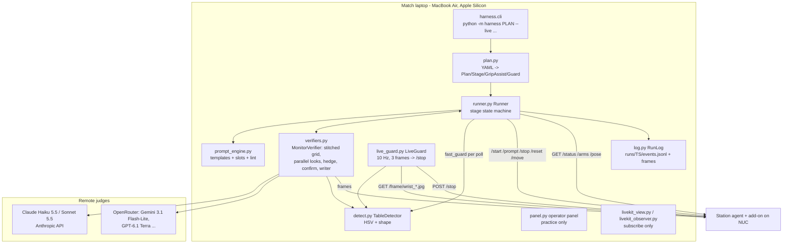

# 3. Harness architecture, end to end

[Back to the index](../TECHNICAL_REPORT.md)

Unless stated otherwise, line references are to **`main@acc1672`**. Components that exist only on side branches
are marked with the branch name.

## 3.1 Principles

1. **Never command a motor.** The harness has no robot driver. It talks only to Dream's station agent and our add-on
   over HTTP. Speed caps, clamps, the control loop and homing stay inside Dream's code. The one exception is the
   add-on's bounded `/move` (≤ 12 cm per call), used by the grip-assist skill while Dream is stopped.
2. **Keep safety off the slow path.** Anything that must stop the arms (the illegal-ball live guard) runs locally at
   frame rate and sends `/stop` itself.
3. **Confirm from independent evidence.** A false "done" on a pass bar is a DQ, so passes need two agreeing looks,
   sensors can veto images, and the same frames judged twice count once.
4. **No free text to the robot** (prompt-engine line). Every instruction comes from a template that worked on the
   station, linted at load.

## 3.2 Component map



| File (main) | Lines | Role |
|---|---|---|
| `harness/cli.py` | 260 | Flags, wiring, refusals (e.g. `--live` + plan guard requires `--detect … --live-guard`, lines 127-136) |
| `harness/plan.py` | 685 | Schema and validation of plans; dataclasses `Recovery` (37), `GripAssist` (50), `Stage` (102), `Guard` (172), `Watch` (189), `Plan` (204) |
| `harness/runner.py` | 1,411 | The supervisor state machine |
| `harness/verifiers.py` | 942 | `manual`, `time`, `claude`, `monitor` verifiers; `MonitorVerifier` (531) with stitch (58), parallel/hedge (555-562), `confirm` (791), `write_prompt` (828) |
| `harness/prompt_engine.py` | 325 | `Library.lint` (79), `parse_library` (105), `DefaultFiller` (182), `ClaudeFiller` (195), `PromptEngine.compose` (271), `prefetch` (289) |
| `harness/detect.py` | 394 | Colour + shape detector; `TableDetector.guard` (348) |
| `harness/live_guard.py` | 196 | `LiveFrames` (35), `LiveGuard` (86-) |
| `harness/hedge.py` | 80 | `first_of`: N copies, first good answer |
| `harness/station_client.py` | 172 | HTTP client; `/move` ≤ 12 cm (139) |
| `harness/frames.py` | 96 | Debug-view trips and light frames |
| `harness/panel.py` | 397 | Operator panel (practice) |
| `harness/livekit_observer.py`, `livekit_view.py` | 323, 192 | Read-only LiveKit |
| `harness/force.py`, `can_torque.py` | 258, 160 | Torque/force estimates from Dream's trace and a passive candump |
| `integrations/station_tools.py`, `dimos_skills.py` | — | DimOS / MCP tools |
| `station_addons/sitecustomize.py`, `pah_hedge.py`, `pah_topdown.py` | — | Station-side add-ons (frames, `/arms`, hedged Dream calls) |

## 3.3 A match, step by step

```mermaid
sequenceDiagram
    participant H as Runner
    participant S as Station agent
    participant M as Monitor (fast) / Confirm (Sonnet)
    participant G as LiveGuard (10 Hz)
    H->>S: GET /status (preflight: idle, arms alive, cameras < 2 s old)
    H->>S: POST /reset (reset_first; skipped while the live guard is armed)
    loop each stage
      H->>G: arm(stage) if the plan guard covers it
      H->>H: compose prompt (template+slots) or stage.prompt
      H->>S: POST /start (first) or /prompt (later)
      loop every check_every_s
        H->>S: GET /status, GET /arms (grip assist polls)
        alt gripper shut on nothing / holding plug (grip_assist)
          H->>S: /stop, /move (regrip / pull up), /start (put-down or re-approach)
        end
        H->>M: look (stitched grid, grip note) - async, parallel
        M-->>H: verdict {done, progress, status, holding, guard}
        alt done twice (confirm 2)
          H->>S: lock: /prompt "open both grippers and move the arms up"
          H->>M: confirm_check (Sonnet, synchronous)
          M-->>H: yes -> stage passes / no -> resume
        end
      end
      G-->>S: POST /stop (3 yes frames in a row on one camera)
    end
    H->>S: POST /stop; POST /reset (reset_last, not after a guard trip)
```

### 3.3.1 Preflight and the guarded `/reset`

`Runner._preflight` (`runner.py:293-314`) refuses to start unless the station is `idle` or `error`, every arm is
alive and every camera frame is younger than `MAX_CAMERA_AGE_S = 2.0` s (line 22). In `--dry-run` the same problems
are logged as warnings.

`_reset_and_wait` (`runner.py:420-433`) sends `/reset` through `_motion` (so an operator stop or a guard trip blocks
it) and **skips it while the live guard is armed**, because `/reset` moves both arms and cannot be cancelled once
begun. This fix came from the `final-harness` merge ("hybrid's `_reset_and_wait` posted `/reset` directly");
`/home` in `home_and_retry` is refused the same way (`runner.py:1395-1396`).

`_motion` (`runner.py:347-356`) wraps every command that can move an arm: it checks the stop event, the clock and
the guard **before** sending, and again **after**, because a guard trip that lands during the command may have been
overtaken by it; in that case it sends `/stop` again and ends the match.

`_safe_stop` (`runner.py:358-370`) sends `/stop` **first and logs after**, so a failing log write cannot keep the
stop from going out (Codex audit A01; `run()` now also catches any `Exception`, `runner.py:267-273`, commit 72bf0b3).

### 3.3.2 Faults from Dream

`_fault_kind` (`runner.py:91-98`) classifies `last_error` text:

| Kind | Keys | Action |
|---|---|---|
| refusal | `DA-4000`, `DreamBadRequest`, `unsafe instruction` | restart the same prompt `REFUSAL_RESTARTS = 1` time, then the attempt fails (`_Refused`) but the match goes on |
| transient | `DreamAPI`, `DreamServerError`, `DreamProtocolError`, `DreamSessionExpired`, `DA-5000`, `DA-6000`, `DA-0001`, `GATEWAY_FAULT`, `connection_timed_out`, `ControlLoopError`, `action buffer empty`, `LinAlgError`, `SVD did not converge` | restart with the same prompt, at most `MAX_STATION_RESTARTS = 5` per run |
| other (arm, motor, safety stop) | — | never retried: `_Fail` → `/stop` |

For `SVD did not converge` / `LinAlgError` the runner first sends a `/reset` (grippers open, arms to the start pose)
and waits for idle, at most `AUTO_RESET_MAX = 2` times per run (`runner.py:37-40, 435-441`), because a plain
`/start` after the IK error often failed again on the station. Before any restart it waits `ARCHIVE_WAIT_S = 4` s so
the station's archiver (3 s poll) copies Dream's run record (run 2 on 8 Nov lost 9 min of record without it,
`runner.py:41-43`).

### 3.3.3 The stage loop (`_watch`, `runner.py:572-837`)

Per poll (every `check_every_s`, 1.0 s in `bot_v1.yaml`):

1. **Grip assist** (if the stage has one) replaces the nap and may drive the arm (§3.6). Time the harness spends
   moving the arm is **not** charged to the stage clock (`t0 += spent`, line 599).
2. **Health** (`_poll_health`): station `error` → fault handling and restart; dead arm → `_Fail`.
3. **Operator** actions (practice only): notes to the monitor, skips, typed prompts.
4. **Local guard** on every poll (`self.fast_guard`, the detector on the latest frames, lines 648-660):
   `guard.confirm` yes answers in a row → `_Guard` → `/stop`.
5. After the gate (`max(min_run_s, settle_s)`), **ask the verifier** (async: the call may still be in flight; the
   verdict that comes back is the newest finished one). Log it with the frames it saw.
6. **Guard from the monitor**: a `guard` yes counts; `max_blind_s` without any guard answer → `_Guard` ("guard blind").
7. **Rewrites / refills** (only without `hands_off`, §3.5).
8. **Progress bookkeeping**: regression (`p ≤ max_p − 0.3`) and stall (`p` not up by 0.05 for `stall_s`) mark a
   failing look, again only without `hands_off`.
9. **Done logic** (two-look confirmation, §3.4) → lock → `confirm_check` → pass.
10. **Timeouts** with two one-time extensions (§3.4.3).

### 3.3.4 Stage results and retries (`_run_stage`, `runner.py:1305-1411`)

`on_fail` ∈ `retry_in_place` (default), `home_and_retry`, `skip`, `abort`, `retry_then_skip` (`plan.py:16`).
Retries use `/prompt` on the running session, not `/stop` + `/start`, because a fresh `/start` costs 2.9 s median.
Pass-bar stages use `max_attempts: 99` ("keep trying until the clock runs out"), because moving on from an unmet pass
bar means touching the next stage's objects (a DQ). The relay state machine adds `retry_then_skip` with Darsh's rule
(2 tries, 3 at ≥ 20 points; pass bars exempt) and `not_after_s` match-clock cutoffs (`runner.py:1242-1243,
1385-1386`; `docs/STATE_MACHINE.md`).

Stage-level skips before a stage starts: `done_before` (`--skip`), `requires_stage` (e.g. no cable came out → nothing
to put down), operator skip, `not_after_s` cutoff, `skip_unless` precondition (one synchronous look), `skip_if_done`
entry check (one synchronous look at confidence ≥ 0.8; audit A02 flagged this for `tower_pass`).

## 3.4 Two-look confirmation and the done logic

### 3.4.1 The rule

```text
done verdict on new frames      -> consec_done += 1
  pass if  verdict.immediate
       or  consec_done >= confirm                    (confirm = 2 in bot_v1 and v4)
       or  a previous done within DONE_WINDOW_S = 15 s ("sticky done")
same frames as the previous done -> not counted ("same_frames" event)
done but the stage needs a grip and no gripper held anything -> ignored ("done_without_grip")
failing verdict within 15 s of a done -> ignored (one flicker does not undo a done)
```

Code: `runner.py:766-801`. The frame signature (`frames_sig`) stops a frozen camera from confirming its own
verdict twice. `needs_grip` uses the gripper-width rules (§5.4).

### 3.4.2 Lock, then confirm (`stop_on_pass`, `_lock_success`, `_confirm_check`)

When a look would pass, and `plan.stop_on_pass` is set, `_lock_success` (`runner.py:1047-1059`) switches Dream to
`lock_prompt` ("open both grippers and move the arms up") **before** the confirming look, or `/stop`s if no lock
prompt is set. Reason (station, 8 Nov): "stack … as high as possible" built a blue-on-blue stack and then took it
apart; in the 13:47–14:28 replay both the 2-high and the 3-high stacks were destroyed by the next prompt. Using a
prompt instead of `/stop` keeps the session warm (a fresh `/start` costs 7–12 s of first answers, commit 86d039d).
Stacking stages set `lock_prompt` to the **next** cube's prompt so the tower "flows" without an arms-up pause
(`plans/bot_v1.yaml:140,156`).

`_confirm_check` (`runner.py:1061-1076`) then asks the confirm model (`claude.confirm_model`, Sonnet 5.5) the stage's
`confirm_check` question synchronously. A "no" resets the done count, appends the reason to the fast monitor's
operator notes, and (with `resume_on_no`) sends Dream back to the prompt it was running. A confirm that cannot answer
passes ("None to pass").

Why a second model: on 8 Nov Gemini 3.1 Flash-Lite (~2.6 s) missed a real unplug and rewrote prompts 11 times in
one run, so every unplug pass is confirmed by Sonnet (`plans/bot_v1.yaml:20-23`). On `claude/engine-bot-live`
(not main) Sonnet also re-checks the tower every 10 s on its own (`confirm_every_s`, commit 28336b0) because the
fast monitor missed a four-cube tower.

### 3.4.3 Timeouts at four levels

| Level | Value | Code |
|---|---|---|
| Match budget | `time_budget_s: 295` (bot_v1); checked in `_check_global` | `runner.py:316-323` |
| Per-stage cutoff on the match clock | `not_after_s` (relay plans: no new plug-in try after 150 s, tower extras by 230 s) | `runner.py:1242`; `docs/STATE_MACHINE.md` |
| Retry budget | `max_attempts` (99 for pass bars, 1 + `on_fail: skip` for bot_v1 stacking) | `runner.py:1365-1369` |
| Per-try timeout | `timeout_s` + one `CONFIRM_GRACE_S = 10` s when a done awaits its confirming look + one `EXTEND_S = 20` s when the monitor sees the gripper on the target with progress ≥ 0.5 | `runner.py:826-837, 1078-1084` |

In the final `bot_v1.yaml` every stage has `timeout_s: 295` ("no per-stage limit (Kaushik, 8 Nov): only the 5 min
match cap").

## 3.5 Prompts: from monitor-written text to the prompt engine

Four generations, all still in the code:

| Generation | Branch | Mechanism | Status on main |
|---|---|---|---|
| Recorded texts, byte for byte | main 7 Nov (`hill_climb_v4.yaml`) | Stage prompts equal the TELEOP_PLAN task texts (T1 `unplug the USB cable at the end of the hub nearest the right arm`, T2 `put the held cable down on the table away from the hub`, …); `python -m harness.tasks PLAN DATASETS` checks every prompt has demos | kept for a fine-tune (`mode: verbatim`) |
| Monitor-written prompts | `combined` / `hybrid-harness` (Kaushik) | The monitor returns `next_prompt`; the runner sends it when the robot is stalled/failing, with a cooldown (15 s) and a cap (3 per attempt), prefixing `prompt_prefix` | kept, but `bot_v1` sets `rewrite_max: 1`, `rewrite_cooldown_s: 30` and `hands_off: true`, which disables mid-attempt rewrites |
| Stage-prompt writer | `claude/bot-prompt-writer` → stitch | `write_prompts: true`: Sonnet writes one instruction per stage from the frames; `writer_notes` constrain it; `SKIP` skips the stage | on for balls only in `bot_v1` |
| Prompt engine | `prompt-engine` → engine-bot | `prompt = template[state, step, variant](slots)`; the monitor's free text is never sent; a stall re-fills slots with the monitor's reason as a hint | on in `plans/engine_bot.yaml` |

### 3.5.1 Prompt engine details (`harness/prompt_engine.py`)

- **L0 library** (plan `prompt_engine.templates` + `vocab`). Each template has `text` with `<slot>` holes, optional
  `prefix: true` (put the "no power" sentence in front), `arm: none|left|right|any`, and `slots: {hole: vocab_list}`.
- **Lint at load** (`Library.lint`, lines 79-94): word cap (`max_words`, 30 by default, 60 in `engine_bot.yaml`); no
  negation (regex `not|no|never|don't|do not|without|except|avoid|instead of|other than`: "not the white ball" put the
  white ball in play in the 8 Nov hand tests); no arm named in an `arm: none` template (stacking: Dream picks the near
  arm); no `forbid` phrase (`white ball`, `8-ball`, …); no unfilled slot. Every vocabulary option is linted, so
  whatever a filler picks is already clean.
- **L1 filler**: `default` (stage defaults, no model), `claude` (one cheap call returning option numbers as
  `<slots>{"piece": 1}</slots>`), or the sim's `OracleFiller` (ground truth). A bad reply or an over-long combination
  falls back to the defaults rather than ending the match.
- **L2 policy** (runner): compose at stage start and on each retry; **variants** — try *n* uses
  `([template] + variants)[(n−1) mod k]` (`runner._variant`, lines 1245-1251), so a failed try is worded differently
  and the slots are re-filled from the scene as it is now; **refill** on a stalled/failing verdict, re-sent only if
  the text changed (each change restarts Dream's motion); **prefetch** of the next stage's slots on the first done
  verdict (`_prefetch_next`, lines 1262-1269), used at the boundary if younger than `prefetch_ttl_s` (20 s).
- **Verbatim mode** for a fine-tune: stage prompts byte for byte; the loader refuses `rewrite_prompts`,
  `write_prompts`, `tower_prompts` or templates with it (`docs/PROMPT_ENGINE.md`).

Second-try variants name **the goal, not the motion** (commit 3e7866c), from the 101-rollout study (§7.6).

### 3.5.2 The byte-for-byte rule and the safety sentence

A fine-tuned Dream-1 only follows its recorded task texts, so for a fine-tune every prompt must equal a recorded
text byte for byte. That is a property of the fine-tune, **not a rubric rule**. The audit (A08) found main and
cloud-sims had switched the default to the fine-tune while still sending untrained texts (`tower_prompts`'s "stand a
stick upright on top of the stack"); 72bf0b3 made `hill_climb_v4.yaml` send only recorded texts on the fine-tune.

Base Dream-1 refuses cable work without a true safety statement (4 × DA-4000 on 7 Nov). The `safe` variable
(`plans/bot_v1.yaml:43`): "The power strip is unplugged from the wall and has no power; the orange cords are
insulated low-voltage USB cables, not bare wires." `FINAL_HARNESS.md` insists: keep it only while it is literally
true. We did not try to trick the filter.

### 3.5.3 Mid-grasp rule

Nothing is re-prompted while a gripper is closed on an object: on the station 9 of 15 judge-written micro-rewrites
were sent while the arm held the plug, and 5 of those dropped it (prompt study U4). `hands_off` (commit 2487a17)
leaves Dream alone between pass, guard and timeout; typed operator prompts turn the grip assist off for that attempt.

## 3.6 Skills: grip assist, pull, drop, lock

`GripAssist` defaults (`plan.py:50-98`) and the values `bot_v1.yaml` uses (lines 105-116):

| Key | Default | bot_v1 | Meaning |
|---|---|---|---|
| `arm` | right | right | arm the skill drives |
| `regrip` | 2 | 2 | re-grips allowed when Dream shut on air |
| `regrip_dz` | −0.015 | −0.025 | lower this far before closing (0 of 6 re-grips held at −1.5 cm live) |
| `pull_up_m` | [0.06, 0.04] | [0.10] | lift steps (each `/move` costs 3–6 s of arm re-sync on the station) |
| `pull_s` | 3.0 | 4 | seconds for the lift |
| `seat_dz` | 0.0 | 0.0 | optional "open a little, lower" before the squeeze |
| `repull` | 2 | 0 | re-pulls after a slip (a re-pull stopped Dream ~19 s live) |
| `hold` | (0.045, 0.20) | (0.062, 0.20) | gripper reading band that means "holding a plug" (empty reads 0.03–0.06 on this station) |
| `open_above` | 0.5 | — | the gripper must have been open on the way in |
| `empty_below` | 0.04 | — | after the squeeze/lift, below this = lost |
| `min_z` | None | 0.035 | never pull from below this tool height (a cable lying on the table reads ~0.023 m) |
| `pass_on_pull` | true | true | a held pull + the confirm count = pass |
| `pull_count_dz` | 0.08 | — | lifted ≥ 8 cm with something still in the jaws → the plug is out, no confirm needed |
| `put_down_prompt`, `put_down_s` | — | the cable prompt, 15 s | hand back to Dream to place the cable |
| `drop_dxyz` / `drop_at` | None | — | carry and open at a relative / absolute point (basket) |
| `loop_until_s` | None | — | keep unplugging the next plug until this match time |

Trigger logic (`_grip_assist_wait`, `runner.py:850-882`): poll `/arms` every `poll_s`; require that the gripper was
open (> `open_above`) on the way in; **regrip** if the last two readings are ≤ `hold[0]` (shut on nothing); **pull**
if the last two are inside the hold band, nothing since the last open was ≤ `hold[0]`, and Dream is commanding the
jaws shut (`cmd ≤ 0.2`) — the last condition came from 8 Nov live data where a half-open approach (0.07–0.17) fired
9 pulls that squeezed air.

Action (`_grip_assist`, lines 891-938; `_pull`, 940-980): `/stop`, wait idle; regrip = open 0.6 → lower `regrip_dz` →
close → re-read; check `min_z` from `/pose`; squeeze in place and re-read (Dream's stop can loosen the jaws); lift by
`pull_up_m`; if it slipped, lower back to where Dream left the hand (a restart from 10+ cm up caused Dream's SVD
error and a full `/reset`); then put-down / drop / re-approach. Every `/move` goes through `_motion`.

The harness pull was the only thing that unplugged reliably on the bot: "2/2 plugs held through the pull on 8 Nov"
(`plans/bot_v1.yaml:4-6`), and in Daniel's study 8 of 12 harness pulls still held the plug after a 10 cm lift (§7.6).
An opt-in station hook (`ee-pull-force`, `PAH_PULL_FORCE_N=r:20`) adds a 20 N upward force while the right gripper
holds; in the 13:47–14:28 replay it **fired 70 times, including on empty closes at home**, and 65 of 70 ended "moved:
out, or nothing held it", which cannot tell a pulled plug from an empty gripper. Verdict there: gate it to unplug
steps or turn it off.

## 3.7 Keeping the policy fed: pacing, light frames, hedging, pipelining

| Change | Where | Effect (as measured) |
|---|---|---|
| Light frames: `/frame/<cam>.jpg?w=640` (~35 KB) instead of ~2 MB debug-view trips | hybrid → main | Dream's round trip went from 2–6 s to ~0.8 s once the harness stopped pulling trips (`FINAL_HARNESS.md`) |
| Dream async pacing at 2 Hz in the sim (`execution_horizon` 10 at 20 Hz), physics never holds for inference | cloud-sims (090df7c) | A laptop match logged **5.96 requests/s at 0.625 s p50 RTT** in a live snapshot (`results/cloud_round1_20261108/laptop/.../hybrid_v4-6/live/status.json`); the final `match.json` of that match says 5.52 Hz |
| `PipelinedPolicy`: two sessions in turn so a request leaves before the previous answer returns | cloud-sims | doubles Dream usage |
| Hedged Dream calls on the station: `HedgedPolicy`, N sessions fed the same observation, first reply drives the arms, losers' sockets cut | `station_addons/pah_hedge.py` (main) | env `PAH_HEDGE_N=2 PAH_HEDGE_CUTOFF_S=1.5 PAH_HEDGE_MAX_CALLS=3`; a cut call may still be billed; tested offline only (`tests/test_pah_hedge.py`) |
| Hedged monitor calls: `claude.hedge: 2` | `harness/hedge.py` | first parseable answer wins; cost × N |
| Parallel staggered looks: `claude.parallel` | `verifiers.py:555-557` | on the station, verdict interval ~9.7 s → ~4.9 s with 2 in flight (`FINAL_HARNESS.md`) |

Pacing facts behind this (`docs/DECISION_MODEL.md` F1–F2, verified in §7.1): Dream's client goes **sync** whenever the
median round trip is over **900 ms**, waiting for each 2.4 s chunk; sync chunks arrived every **3.54 s** (median)
against **1.55 s** in async mode, so the arms stood still about 30 % of the time. The round trip is ~950 ms even with
a fast uplink because roughly **650 ms is gateway overhead** we cannot change: on chunks with ≥ 50 Mbit/s uplink the
median RTT was 900 ms with a 293 ms model time (our recomputation: ~607 ms overhead; over all chunks RTT − serve −
network has a median of 740 ms). Each request carries ~1.6 MB of images, so uplink matters: chunks at ≤ 9 Mbit/s had
a median RTT of 2.2 s.

The Dream Labs engineer's advice behind hedging (8 Nov): "fire a new call every 1–2 s and use the first good
answer" (`station_addons/pah_hedge.py:4-7`).

## 3.8 The 10 Hz live guard

`harness/live_guard.py`. A thread reads both wrist frames (`/frame/wrist_l.jpg`, `/frame/wrist_r.jpg`) in parallel at
`rate_hz = 10`, each fetch with a 0.25 s timeout so a dead camera never holds up the live one. The detector's guard
(`TableDetector.guard`) judges each **new** frame (SHA-1 of the bytes): an unchanged frame neither adds a yes nor
refreshes `last_answer_t`, so a frozen camera shows up as **blindness** (`max_blind_s`, 20 s in `bot_v1`) rather than
"all clear". Yes answers are counted **per camera**; `confirm_frames = 3` in a row on one camera send `/stop`
immediately (0.3–0.5 s after the ball enters view), without waiting for the runner. Arming has a generation number so
a judgement started before a disarm is dropped. The runner re-checks `tripped` around every motion command
(`_motion`) and inside every wait (`_wait`, 1 s slices). The live guard only reads `/frame` and only sends `/stop`.

`--live` refuses to start a plan that has a `guard:` without `--detect plans/table_colors.yaml --live-guard`
(`cli.py:130-136`; override `--allow-no-live-guard` for practice).

**Known limitations** (audit A06/A07 and this report's own test, §5.2.4): the guard returns "none held" if any
readable wrist view is clear, so a missing right-wrist frame is masked by the left; and the white range on main is
the phone-photo range.

## 3.9 The start-pose gate (side branches only)

`harness/start_pose.py` (on `start-pose-live-guard` and the cloud-sims family, **not on main**). Reference: the first
frame of every task segment in the teleop episodes, keyed by the exact task text (`plans/start_poses.json`, built by
`tools/start_poses.py`). Joint state comes from `GET /arms` `positions_rad` or the newest trip's observation. Before
each stage the harness logs the distance to the recorded starts for that prompt; on stages marked `home_before` it
homes once if any joint is more than **0.35 rad** from every recorded start (paper §4.7). Motivation: LIBERO-Plus
reports the initial state as the largest single robustness loss for a VLA, and the FT diagnosis found only 9 of 69
unplug demos started within 0.3 rad of the home pose every live run starts from. The audit (A25) notes the gate is
advisory on several failure paths.

## 3.10 Shadow-mode decisions (side branches only)

`harness/decide.py` (cloud-sims family) runs the decision model of §4 **next to** the runner and logs what it would
have done ("Decide shadow mode", c2098dc). With default weights it reproduces the runner's pass decision exactly on
5,000 random look sequences (`tests/test_decide.py:48`). `harness/statespace.py` (hedged-calls → cloud-sims) is the
same logic as a vectorised state-space system for hill-climbing thousands of weight sets over logged runs (§4.5).
Neither ever made a match decision.

## 3.11 Observers and integrations

- **LiveKit observer** (`harness/livekit_observer.py`, ported from `codex/hill-climb-livekit` 569607e via 76cc686 and
  b3c27fb): subscribes to the room's camera tracks and can run the monitor on a stage; logs advisory verdicts; never
  part of the run. `relay-on-stitch` (f8771cd) mints a **subscribe-only** token from `LIVEKIT_API_KEY` /
  `LIVEKIT_API_SECRET` + `--room` when `LIVEKIT_TOKEN` is unset.
- **LiveKit viewer** (PR 9, `harness/livekit_view.py`): view-only camera card in the panel and standalone on port
  8098; minted tokens have publish and publish-data off; `livekit` is imported on the viewer's thread only. Purpose:
  the rubric's +10 for showing LiveKit to the referee.
- **DimOS** (`integrations/dimos_skills.py`, `integrations/station_tools.py`): the harness's primitives as DimOS
  skills / MCP tools (`list_stages`, `start_stage`, `check_stage`, `recover`, `stop_robot`, `status`, `run_plan`,
  `plan_status`). All go through Dream's station API; there is deliberately no tool that moves a joint, homes or
  resets; `send_prompt` (free text) is off unless `allow_free_prompts=True`. Purpose: the rubric's +5 for Dimensional.
- **Watcher arm** (`codex/watcher-dimos` → main 6264ca9): `stage.watch` puts one arm's wrist camera on the work and
  re-sends a park prompt if the monitor says the watcher drifted (`watch_lost`, `runner.py:753-765`). Base Dream-1
  does not reliably obey arm naming (§7.5), so this was never used in a match plan.
- **Panel** (`python -m harness.panel`, kaupau): starts a run (base or fine-tune, which stages), shows cameras, every
  prompt sent and why, the harness's own actions and monitor looks; sends `!prompt` / `!skip` overrides. Practice only.

## 3.12 Logs

`runs/<UTC timestamp>/events.jsonl` (one JSON event per decision: `stage_start`, `prompt_change`, `verdict`,
`grip_assist`, `grip_pull`, `stage_locked`, `confirm_check`, `guard_tripped`, `station_restart`, …), the frames each
verdict looked at, `segments.jsonl`, `manifest.json`, `summary.json`. `tools/label_rollout.py` joins these to Dream's
own run record (`inputs.jsonl`) to label rollouts with stage, attempt, outcome and a clean task text — the bridge
from harness runs to fine-tune data. `tools/bot_report.py` and `tools/trace_report.py` render run pages.
